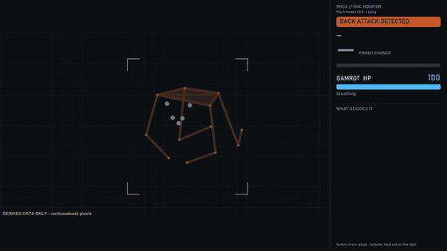
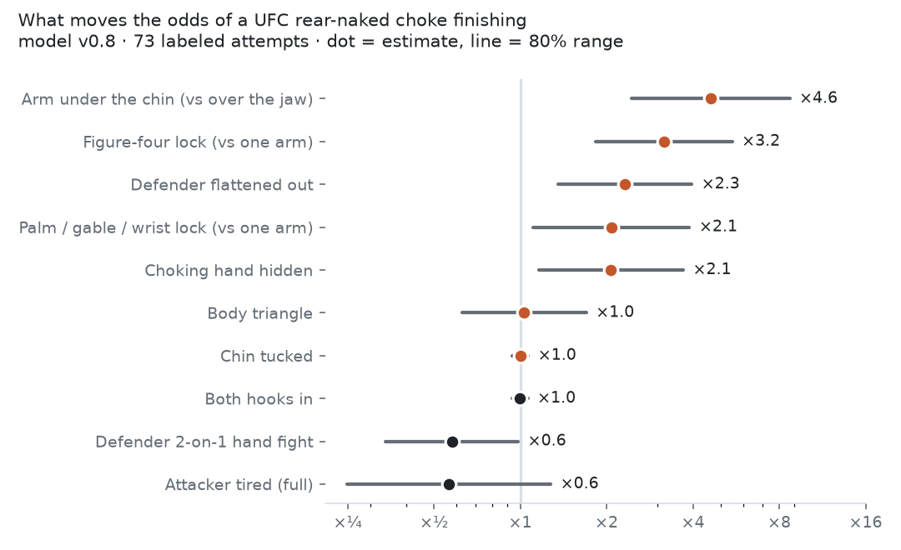
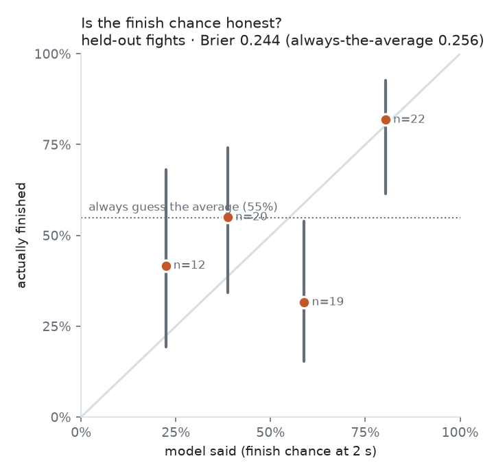
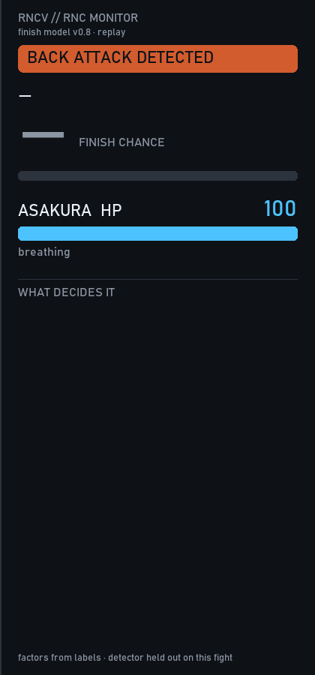

# RNCV: what makes a UFC rear-naked choke finish?

**Commentators say a choke is "in deep". This project measures it.** RNCV (RNC + computer vision) is a pre-registered study of 75 hand-labeled rear-naked choke attempts from 43 UFC fights, a live finish-probability model, and an automatic back-attack detector. No UFC footage is published: only labels, numbers and code.

**In 30 seconds**
- **What decides a finish so far:** the arm under the chin (61% finished vs 40% over the jaw), a figure-four grip (68% vs 42% with one arm), a hidden choking hand (75% vs 48%), and a flattened defender (66% vs 49%).
- **The surprise:** leg control doesn't help a single attempt finish. It seems to buy retention and re-attacks instead.
- **A check against physiology:** finished chokes took a median 9.6 s on the neck; a published study of 81 MMA choke-outs found 9.0 s.
- **The honest part:** it's a pilot. The sample is small and tilted toward finishes, and the confirmatory test runs at ~150 attempts ([why 150](research/rnc_science/POWER_NOTE.md)).

**Try it:** [interactive explorer](docs/explorer/index.html) (no footage) · [pilot report](docs/paper/PILOT_REPORT.md) · [local detector app](tools/app/README.md)

| | Status |
|---|---|
| 🟢 Works | Hand-labeled dataset with blind coding and QA; finish model and HP meter; replay overlay; the detector finds back attacks on full broadcasts (frame ROC-AUC ~0.75, catches 95% of attempts) |
| 🟡 Partly | The finish model beats a base-rate guess only slightly from one snapshot, and clearly when it follows the position |
| 🔴 Not yet | The computer can't read the details (arm, grip, legs) by itself; it misses the exact second a choke starts; it doesn't carry over to edited highlight reels |

### What the computer sees (footage-free replay)



Oliveira vs Gamrot, drawn only from derived data: the pose model's confident joints (with motion trails), the fighters' box, the reticle locked on the neck, and the side tab. The real detector flags the back attack (trained without this fight), the finish chance climbs as the figure-four goes in, and Gamrot's HP drains to the tap. No broadcast pixels: made with `python tools/mvp/demo.py <clip> --no-pixels`.

---

## Results so far (honest numbers)

| Piece | Result | What it means |
|---|---|---|
| Labeled data | 75 attempts from 43 UFC fights, men's divisions | Too few for the pre-registered analysis yet (needs ~150) |
| Finish model v0.8 | Brier 0.245 at 2 s vs 0.254 for always guessing the average; 0.224 vs 0.254 as the position changes | Following the position adds real information; the 2-s snapshot alone is within noise so far |
| Defender HP (choke dose) | Pantoja vs Asakura: hits 0 at 18 s, he went out at 19 s; labeled finishes took a median 9.6 s on the neck | Timing from physiology (≈9 s, Stellpflug 2020), not fitted |
| Attempt detector v2 | Frame ROC-AUC ~0.75, leave-one-fight-out, 40 fights, ~65 min of no-attempt footage; catches 95% of attempts at ~0.5 false alarms per minute | Spots back attacks; not yet the second the choke starts. The demo's "BACK ATTACK DETECTED" comes from it |
| Pose skeletons | Both fighters correct in 4/48 tangled frames | Parked; the overlay draws only confident parts (box, heads) |

### The science so far (pilot data; the pre-registered test waits for ~150 attempts)



The arm under the chin, a flattened defender and a locked grip push the finish odds up. The defender's two-on-one hand fight pulls them down. Wide lines mean the data can't pin an effect down yet. Body triangle vs hooks shows no clear effect so far, which isn't what coaches expect, and it's one to watch as labels grow.



On fights it never saw, the strongest positions (model says ~80%) did finish ~80% of the time. Below that, the model is still too pessimistic: its 20% bin finished ~45% of the time. The overall gain over guessing the average is small at this sample size.

Model details: [docs/MODEL_SPEC.md](docs/MODEL_SPEC.md) · Expert review: [research/coach_review/COACH_REVIEW.md](research/coach_review/COACH_REVIEW.md) · Evidence review: [research/priors_evidence/EVIDENCE.md](research/priors_evidence/EVIDENCE.md)

## How the two readouts work

- **Finish chance (attacker):** *given the position visible right now* (arm under the chin, grip type, legs, the defender's two-on-one, chin tucked...), what fraction of similar UFC attempts end in a finish? It jumps when the grip locks and drops when the defender fights the hands. There is no time ramp. At the tap it reads 100%, because the finish has happened (planned: show **RESULT: TAP** there instead).
- **Choke meter (defender):** a modeled running dose of choking, not a medical measurement. It drains fast under a locked choke below the chin, barely moves over the jaw, and refills when the defender breathes again.
- **Grip (attacker):** the attacker's arms tire the longer they squeeze, which slowly lowers the finish chance.

Readouts come from **labeled positions** for now, not from live computer vision.



**Example (footage-free replay of the side tab):** Pantoja vs Asakura, UFC flyweight title, round 2, scored by models that never saw this fight. The real detector flags the back attack. The finish chance sits near 26% while the arm is over the jaw, then jumps to ~89% when the figure-four locks under the chin. Asakura's HP drains with an estimate of the seconds of air left. The boxes show what decides it (gold = very helpful, purple = helpful, blue = small, red = against). Made with `python tools/mvp/demo.py <clip> --panel-only`, which writes only the tab, never video pixels.

<br clear="right">

---

## Repo map

| Folder | What's in it |
|---|---|
| [research/rnc_science/](research/rnc_science/) | Pre-registration and the code book of choke factors ([FACTORS.md](research/rnc_science/FACTORS.md), [pictures](docs/rnc_codebook.html)) |
| [research/model/](research/model/) | Finish model, priors, validation runs |
| [phase3_labels/](phase3_labels/) | `labels.csv`, fight queues, schema, QA script |
| [tools/](tools/) | Browser labeler, overlay demo, renderer, eval harness |
| [src/](src/) | Pose, two-fighter tracking, referee filter, side experiments |
| [reports/](reports/) | Every result as markdown, JSON and plots |
| [docs/](docs/) | Plan, roadmap, model spec, guides, [operations how-tos](docs/OPERATIONS.md) |
| `data/`, `models/` | Local only (git-ignored): clips, datasets, weights |

**Side experiment:** a grappling-position classifier on the open VICOS dataset (macro-F1 0.63, not UFC data). See [docs/OPERATIONS.md](docs/OPERATIONS.md) and [reports/TRAINING_STATUS.md](reports/TRAINING_STATUS.md).

## Setup

```bash
python -m venv .venv            # on Windows, put the venv at a short path if OpenCV DLLs fail to load
python -m pip install -r requirements.txt
curl -L --fail -o data/raw/vicos/annotations.json https://data.vicos.si/datasets/JuiJuitsu/annotations.json
```
> Three environments are used in practice: pose + training (`requirements.txt`, rtmlib, onnxruntime), tools (OpenCV, pandas, Pillow, Kaggle CLI), and image features (open_clip, torch CPU).

**Play with the model:** open [docs/explorer/index.html](docs/explorer/index.html) in a browser: set the arm, grip, legs and hand fight, press play, and watch the finish chance and HP (no footage, runs entirely in the page).

**Test the detector yourself:** `python -I tools/app/serve.py` starts a local app (drop a clip, the detector analyses it, you play it back with the readouts). See [tools/app/README.md](tools/app/README.md).

How-tos (labeling, Kaggle, training, pose runs): [docs/OPERATIONS.md](docs/OPERATIONS.md). Roadmap: [docs/ROADMAP.md](docs/ROADMAP.md).

## Footage and licenses

- UFC footage: private local clips only, never uploaded; only derived data is committed. See [docs/FOOTAGE.md](docs/FOOTAGE.md).
- VICOS: CC BY-NC-SA 4.0 (cite Hudovernik & Skočaj, MMSports'22). YOLO11: AGPL-3.0. RTMO/MMPose/rtmlib: Apache-2.0. Full table: [DOWNLOADS.md](DOWNLOADS.md).
