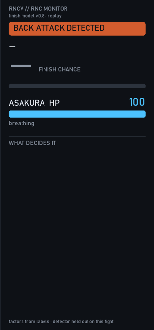

# RNCV: what makes a UFC rear-naked choke finish?

RNCV (**RNC + CV**, computer vision) asks a BJJ question with data: *which details of a rear-naked choke decide whether a UFC fighter taps?* It has three parts:

1. **A pre-registered study** of hand-labeled UFC choke attempts: 36 so far, target ~150. The hypotheses were frozen before labeling ([PREREG](research/rnc_science/PREREG.md)).
2. **A replay overlay** with two readouts. The attacker's **finish chance** is a forecast that the attempt ends in a tap or stoppage. The defender's **choke meter** shows how much choking they have already absorbed.
3. **An early automatic attempt detector** (experimental).

**Status: early.** The finish model mixes expert priors (the owner's BJJ judgment plus a published-evidence review) with a small labeled set. So far it beats a base-rate guess only slightly. UFC footage is never published: the repo holds only derived data (timestamps, labels, keypoints).

---

## Results so far (honest numbers)

| Piece | Result | What it means |
|---|---|---|
| Labeled data | 36 attempts from 20 UFC fights, men's divisions | Too few for the pre-registered analysis yet (needs ~150) |
| Finish model v0.6 / v0.7c | Brier 0.226 / 0.228 at 2 s (0.205 / 0.204 over every second) vs 0.270 for always guessing the average | Sensible in replay; the gain over a base rate isn't certain yet. v0.7c adds grip type, body triangle vs hooks and the coach review |
| Choke meter | Pantoja vs Asakura: hits 0 at 18.0 s; he went out at 19.0 s | Timing comes from physiology (≈9 s from lock to out, Stellpflug 2020), not from fitting |
| Attempt detector v2 | Frame ROC-AUC 0.74 (was 0.70), PR-AUC 0.55 vs 0.29 base rate; leave-one-fight-out, 19 fights | Recognizes the exchange, not the moment the choke starts (correct start on ~8–22% of attempts); the overlay uses a manual "attempt starts" key |
| Pose skeletons | Both fighters correct in 4/48 tangled frames | Parked; the overlay draws only confident parts (box, heads) |

Model details: [docs/MODEL_SPEC.md](docs/MODEL_SPEC.md) · Expert review: [research/coach_review/COACH_REVIEW.md](research/coach_review/COACH_REVIEW.md) · Evidence review: [research/priors_evidence/EVIDENCE.md](research/priors_evidence/EVIDENCE.md)

## How the two readouts work

- **Finish chance (attacker):** *given the position visible right now* (arm under the chin, grip type, legs, the defender's two-on-one, chin tucked...), what fraction of similar UFC attempts end in a finish? It jumps when the grip locks and drops when the defender fights the hands. There is no time ramp. At the tap it reads 100%, because the finish has happened (planned: show **RESULT: TAP** there instead).
- **Choke meter (defender):** a modeled running dose of choking, not a medical measurement. It drains fast under a locked choke below the chin, barely moves over the jaw, and refills when the defender breathes again.
- **Grip (attacker):** the attacker's arms tire the longer they squeeze, which slowly lowers the finish chance.

Readouts come from **labeled positions** for now, not from live computer vision.



**Example (footage-free replay of the readouts):** Pantoja vs Asakura, UFC flyweight title, round 2, scored by a model that never saw this fight. The finish chance sits near 30% while the arm is over the jaw. It jumps to ~92% when the figure-four locks under the chin, and holds ~88% through Asakura's late two-on-one, because the choking hand is hidden. The choke meter drains to 0 at about 18 s; he went out at 19 s. Made with `python tools/mvp/demo.py <clip> --model v07c --panel-only`, which writes only the panel, never video pixels.

<br clear="right">

---

## Repo map

| Folder | What's in it |
|---|---|
| [research/rnc_science/](research/rnc_science/) | Pre-registration and the code book of choke factors ([FACTORS.md](research/rnc_science/FACTORS.md), [pictures](docs/rnc_codebook.html)) |
| [research/model/](research/model/) | Finish model, priors, validation runs |
| [phase3_labels/](phase3_labels/) | `labels.csv`, fight queues, schema, QA script |
| [tools/](tools/) | Browser labeler, overlay demo, renderer, eval harness |
| [src/](src/) | Pose, two-fighter tracking, referee filter, side experiments |
| [reports/](reports/) | Every result as markdown, JSON and plots |
| [docs/](docs/) | Plan, roadmap, model spec, guides, [operations how-tos](docs/OPERATIONS.md) |
| `data/`, `models/` | Local only (git-ignored): clips, datasets, weights |

**Side experiment:** a grappling-position classifier on the open VICOS dataset (macro-F1 0.63, not UFC data). See [docs/OPERATIONS.md](docs/OPERATIONS.md) and [reports/TRAINING_STATUS.md](reports/TRAINING_STATUS.md).

## Setup

```bash
python -m venv .venv            # on Windows, put the venv at a short path if OpenCV DLLs fail to load
python -m pip install -r requirements.txt
curl -L --fail -o data/raw/vicos/annotations.json https://data.vicos.si/datasets/JuiJuitsu/annotations.json
```
> Three environments are used in practice: pose + training (`requirements.txt`, rtmlib, onnxruntime), tools (OpenCV, pandas, Pillow, Kaggle CLI), and image features (open_clip, torch CPU).

How-tos (labeling, Kaggle, training, pose runs): [docs/OPERATIONS.md](docs/OPERATIONS.md). Status: [PROGRESS.md](PROGRESS.md) · [Roadmap](docs/ROADMAP.md).

## Footage and licenses

- UFC footage: private local clips only, never uploaded; only derived data is committed. See [docs/FOOTAGE.md](docs/FOOTAGE.md).
- VICOS: CC BY-NC-SA 4.0 (cite Hudovernik & Skočaj, MMSports'22). YOLO11: AGPL-3.0. RTMO/MMPose/rtmlib: Apache-2.0. Full table: [DOWNLOADS.md](DOWNLOADS.md).
