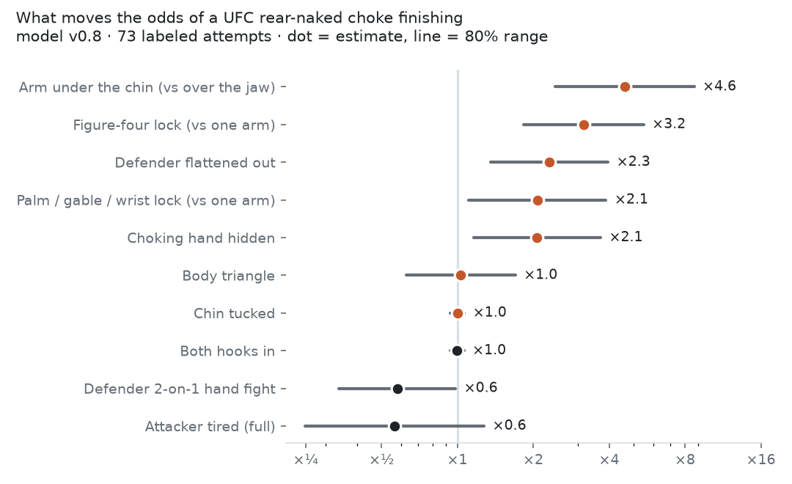
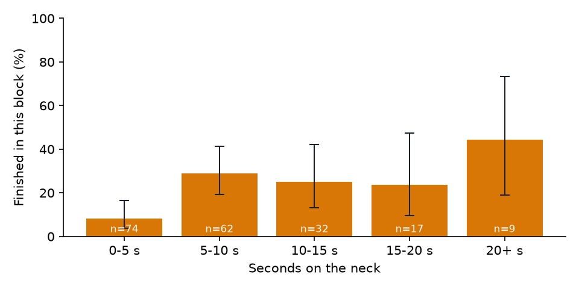
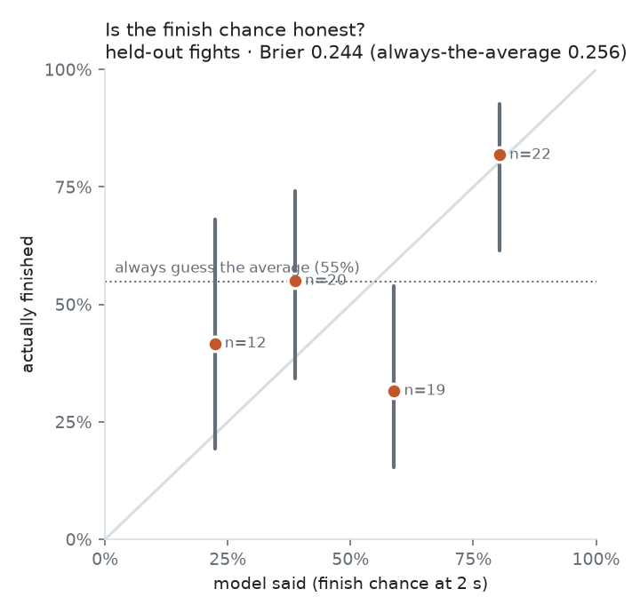

# What finishes a UFC rear-naked choke, and can a computer see it?
### A pre-registered study of 75 hand-labeled attempts and a first test of automatic reading (pilot report)

*Pilot report, 2026-11-01. 75 attempts from 43 men's UFC fights. The confirmatory test runs at ~150 attempts; every result below is exploratory unless marked otherwise. Code, labels and figures are in this repository. No UFC footage is included or redistributed.*

---

> **In plain words.**
> - I hand-labeled 75 rear-naked choke attempts from UFC fights: where the choking arm was, how the hands were locked, what the legs were doing, how the defender fought it, and whether it finished.
> - In this first sample, four details lined up with more finishes:
>   - the arm under the chin (59% finished vs 40% over the jaw);
>   - a figure-four grip (68% vs 38% with one arm);
>   - a hidden choking hand (75% vs 46%);
>   - a flattened defender (63% vs 48%).
> - **These are directions, not proof.** With the labels alone, every one of these effects still has an uncertainty range that includes "no effect". The sample is too small to be sure.
> - Strong leg control did **not** help a single attempt finish. One explanation is that it keeps the attacker on the back for more attempts rather than finishing any one of them. A first test of that idea didn't confirm it.
> - Finished chokes took a median of 9.6 seconds on the neck, almost exactly what a published study of MMA choke-outs found (9.0 s).
> - The real test was written down in advance and runs at 150 attempts.
> - **Can a computer do this alone? Not yet.** It finds back attacks on full broadcasts, but it can't read the arm or grip, and from video alone its odds and timing are no better than guessing the average.

---

## Abstract

**Background.** The rear-naked choke (RNC) is the most common submission in the UFC. Coaching folklore names its key details, but no study has measured which of them separates finished chokes from escaped ones at the elite level.

**Method.** Three hypotheses were pre-registered before any labeling:
- H1: the arm under the chin raises the odds of a finish;
- H2: strong leg control raises them;
- H3: the defender's two-on-one hand fight lowers them.

Attempts were coded at a fixed landmark (2 s after the start) with a purpose-built tool that hides the outcome.

**Pilot results** (exploratory; 74 analysable attempts, 43 fights; 95% Wilson intervals):
- Arm under the chin: 59% finished (46–70%) vs 40% (20–64%) over the jaw.
- Figure-four: 68% (51–80%) vs 38% (21–59%) for one-armed chokes.
- Hidden choking hand: 75% (53–89%) vs 46% (34–59%).
- Strong leg control: no advantage per attempt.
- Labels-only odds multipliers (no priors) point the same way but are inconclusive: arm ×2.8 (0.8–10.9), figure-four ×2.4 (0.6–10.6), hidden hand ×3.2 (0.6–20), flattened ×1.9 (0.7–5.9), two-on-one ×0.73 (0.2–2.6). A Bayesian model that adds expert priors gives firmer numbers (×4.6, ×3.2, ×2.1, ×2.3, ×0.58), which rest partly on those priors.
- Median time on the neck to a finish: 9.6 s.

**Can a computer see it?** Everything below was tested on fights left out of training.
- Hand labels into a model give a replay finish chance. From the 2-s snapshot it barely beats a base-rate guess (Brier 0.244 vs 0.256). Following the position as it changes, it does clearly better (0.223 vs 0.256).
- An automatic detector finds back attacks with a frame-level ROC-AUC of about 0.75.
- Reading the details from video is near chance (best κ 0.24, bar 0.4), and odds from video alone show no gain (Brier 0.256 vs 0.257).

**Conclusion.** The pilot points the way coaching expects for the arm, the grip and the hidden hand, without proving any of them yet. It challenges the role of leg control per attempt. The computer finds the moment but can't yet read the choke. The confirmatory test waits for 150 attempts.

---

## 1. Why this project

This started as a crossover between data science and my love of MMA grappling. Watching UFC fights, I kept hearing commentators say a choke was "in deep" or "not under the chin". I wanted to know whether those calls could be measured, how much each detail actually matters, and whether a computer could make the same calls from video.

The rear-naked choke is the right place to start:
- **It's common.** RNCs are about half of all UFC choke finishes (Stellpflug 2020: 904 choke finishes, 1993–2020).
- **It's mostly visible.** A broadcast often shows the arm and hands, which makes it a fair test of what video alone can reveal.
- **There is a clear expert theory to test:** coaches agree on the arm, the grip, the legs and the hand fight.

**Two questions:**
1. *Among UFC rear-naked choke attempts, which technical states at a fixed early moment are associated with the attempt finishing?*
2. *How much of that can a computer read on its own from broadcast video: the attempt, the details, the odds and the time to a finish?*

The first is pre-registered. The second is exploratory engineering, tested on fights left out of training. An honest "not yet" counts as a result: it shows where broadcast video stops being enough.

**How a blood choke works.** A rear-naked choke doesn't work by cutting off air. Two carotid arteries run up the sides of the neck and carry most of the brain's blood. The attacker's biceps presses one side and the forearm presses the other, with the crook of the elbow under the chin, so the windpipe sits in the gap. Blood flow to the brain drops, and the defender either taps or loses consciousness. Once the squeeze is released, blood returns and a fighter usually wakes quickly.

This is why the details matter. An arm under the chin reaches the arteries, while a forearm across the jawbone rests on bone and shields them. A locked grip lets the attacker hold that squeeze with both arms.

**What is already known.** Stellpflug et al. (2020) timed 81 MMA choke-outs: from a locked choke to unconsciousness took 9.0 s on average (95% CI 8.3–9.9 s; RNC 8.9 s). No study compares grip types or leg control as predictors of the finish ([evidence review](../../research/priors_evidence/EVIDENCE.md)).

## 2. Pre-registration: deciding the test before seeing the data

With dozens of possible details and a small sample, *something* will always look important by chance. To guard against that, the hypotheses and the exact analysis were written down and frozen ([PREREG.md](../../research/rnc_science/PREREG.md), v1.0) before the first attempt was labeled.

| # | Detail at 2 s | Prediction |
|---|---|---|
| H1 | Choking arm under the chin (vs over the jaw) | More finishes |
| H2 | Body triangle or both hooks (vs less) | More finishes |
| H3 | Defender's two-on-one hand fight | Fewer finishes |
| — | Time left in the round | Adjustment only |

**H4, added later (A7): grip ladder.** Better grips finish more: figure-four > two-handed lock without the biceps anchor (palm-to-palm, gable, wrist pull) > no real lock (one arm, short choke). In a figure-four, the choking hand anchors on the attacker's own biceps, so the second arm adds force behind the head and the hand is hard to peel off. Two-handed locks have grip strength but no anchor, and a one-armed choke has neither. H4 was added on 2026-11-01, after the pilot's grip numbers had been seen, so these 75 attempts can't confirm it. It is tested only on attempts labeled after that date, in its own model, with the arm position held fixed. At 75 new attempts the chance of confirming it is about 75% if the pilot's effect is real (×2.1 per step), and about 32% at ×1.5 (simulated estimates).

**Decision rule, fixed in advance.** A hypothesis is:
- *supported* if its 95% interval excludes "no effect" in the predicted direction;
- *contradicted* if it excludes it in the opposite direction;
- *inconclusive* otherwise, which is a legitimate result.

**Amendments are dated and public, never silent:**
- A1: men's divisions only.
- A2: an upper-body field and a position change log, for descriptive use.
- A3, A4: a cap of 5 attacking rounds per fighter, so one specialist can't dominate.
- A5: an exploratory field for damage going into the choke, added after a first look at strike stats, so it stays exploratory.
- A6: long-control rounds added for computer training; every analysis also reports results without them.
- A7: H4, the grip ladder, tested only on attempts labeled after 2026-11-01.
- A8: reliability in two checks, a self re-code and a smaller second-rater set. This is weaker than the original plan of 30 second-rater attempts.

## 3. Data

**Population:** men's UFC fights, 2018–2026, with at least one RNC attempt. Women's fights are left out because finishing may differ and about 150 attempts can't power that comparison (A1). Men's fights should also suit the computer part: men fight shirtless, so more skin shows where bodies and arms begin and end, while rash guards hide more. That second reason is expected, not tested. Findings apply to men's divisions only.

**Sampling**, in plain terms:
- **Finish list.** Watching full fights at random to find chokes would take hundreds of hours, so most attempts come from fights known to end in an RNC (677 such finishes in the UFC's stats). This inflates the *overall* finish rate, but the *comparisons* between details stay valid, and those are what the hypotheses test. (Technically: sampling on the outcome biases the intercept of a logistic model, not its odds ratios.)
- **Failure rounds.** Rounds with flagged submission attempts that didn't finish.
- **A random subset** (planned): about 10 fully watched fights, for an honest base rate.

**Every** attempt in a watched round is labeled, including failed attempts before a finish.

**This pilot:** 75 attempts from 43 fights; 74 are analysable (one ended at the bell). 64 come from finish-list fights and 10 from failure rounds. The sample is heavily tilted toward finishes: 54% finished overall, far above reality. **Read the rates as comparisons with each other, never as real-world chances.**

**Footage:** the labeled fights use official UFC uploads and licensed broadcasters, watched locally. Later rounds picked for computer training may use vetted fan uploads, marked as such. Videos stay on one local laptop and are never uploaded; only labels and derived data are published.

## 4. How an attempt is coded

**What counts as an attempt:**
- the attacker has back control;
- the choking arm is across the neck (under the chin or over the jaw);
- the second hand is working to lock it.

If the choke is reset in under 2 seconds without losing the back, it's still the same attempt.

**The 2-second landmark.** A labeling tool written for this project pauses the video 2 seconds into each attempt and asks a fixed panel of questions *before* the outcome is visible:
- arm position;
- grip type;
- leg control;
- the defender's two-on-one;
- chin tucked;
- choking hand hidden;
- defender flattened.

Coding at a fixed early moment, blind to the outcome, prevents the natural bias of describing finished chokes as "tighter". Changes after the landmark (e.g. the grip switching to a figure-four) are logged with timestamps.

**Outcomes:**
- **Success:** tap, referee stoppage or unconsciousness.
- **Failure:** escape or the attacker abandoning the choke.
- **Censored:** the round ends first (a "bell").

**Quality control** is automated: overlapping attempts, impossible times, mismatches with official finish times, out-of-scope fights and cap violations. The pilot passes with zero errors.

**Reliability** (🔴 pending), in two checks:
- **Same coder:** I re-code 20–30 attempts weeks later, without seeing my first labels. This shows whether the calls are consistent, not whether another person would agree.
- **Second rater:** a second person codes about 15 of the same attempts, blind to the outcome.

Any detail with agreement below κ = 0.4 (Cohen's kappa: agreement beyond chance, from 0 to 1) will be reported as "not reliably codable from broadcast".

## 5. Results (exploratory)

### 5.1 Finish rate by detail

Rates at the 2-second landmark, with 95% Wilson intervals: the range the true rate plausibly lies in, given the sample size. Source: [findings_pilot.md](../../reports/findings_pilot.md).

| Detail | Value | Attempts | Finished | 95% interval |
|---|---|---|---|---|
| **Arm** (H1) | under the chin | 58 | **59%** | 46–70% |
| | over the jaw | 15 | 40% | 20–64% |
| **Grip** | figure-four | 37 | **68%** | 51–80% |
| | palm / gable / wrist pull | 10 | 50% | 24–76% |
| | one arm / short choke | 21 | 38% | 21–59% |
| **Legs** (H2) | body triangle | 24 | 46% | 28–65% |
| | both hooks | 27 | 52% | 34–69% |
| | one hook / none | 23 | **65%** | 45–81% |
| **Defender two-on-one** (H3) | yes | 23 | 57% | 37–74% |
| | no | 51 | 53% | 40–66% |
| **Choking hand hidden** | yes | 20 | **75%** | 53–89% |
| | no | 54 | 46% | 34–59% |
| **Defender flattened** | yes | 30 | **63%** | 46–78% |
| | no | 44 | 48% | 34–62% |

### 5.2 Effects with the other details held fixed

The raw rates mix details together: deep chokes tend to be figure-fours with the arm under the chin. A logistic model separates them by estimating how much each detail multiplies the odds of a finish while the others stay the same. Two versions are shown:
- **Labels only:** a Firth logistic with no outside input ([labels_only.md](../../reports/labels_only.md)).
- **Model v0.8:** the applied model, which starts from expert estimates and a published-evidence review, then updates on the labels ([MODEL_SPEC.md](../MODEL_SPEC.md)).

| Detail (others held fixed) | Labels only (95% interval) | Model v0.8 (with priors) |
|---|---|---|
| Arm under the chin (vs over the jaw) | ×2.77 (0.76–10.93) | ×4.62 |
| Figure-four (vs one arm) | ×2.43 (0.61–10.55) | ×3.17 |
| Other lock (vs one arm) | ×1.83 (0.41–8.55) | ×2.08 |
| Body triangle (vs one hook / none) | ×0.36 (0.09–1.38) | ×1.03 |
| Both hooks (vs one hook / none) | ×0.51 (0.14–1.79) | ×1.00 |
| Defender two-on-one | ×0.73 (0.20–2.58) | ×0.58 |
| Choking hand hidden | ×3.21 (0.62–20.02) | ×2.07 |
| Defender flattened | ×1.90 (0.66–5.86) | ×2.32 |

**Every labels-only interval includes ×1 (no effect).** The directions match coaching for the arm, the grip, the hidden hand, the flattened defender and the two-on-one, and leg control leans the opposite way, but 67 complete attempts can't settle any of them. Where the two columns differ, the model's number leans on the priors.

*Figure 1.* Model v0.8 multipliers, which include the expert priors. Their ranges are narrower than the labels-only intervals for that reason.

### 5.3 Time on the neck

| | Median | Middle half |
|---|---|---|
| Finished chokes (n = 40) | **9.6 s** | 6.5–12.9 s |
| Failed attempts (n = 34) | 9.6 s | 6.2–15.4 s |

Finishes landed at almost exactly the 9.0 s from lock to unconsciousness measured in MMA (Stellpflug 2020), an independent check on the labels. Duration alone doesn't separate finishes from failures; position does.

**When finishes happen.** Of the 74 attempts, 8% finished in the first 5 seconds. Of those still going, 29% finished in the 5–10 s block, 25% in 10–15 s and 24% in 15–20 s. So the danger arrives after about 5 seconds, then stays roughly flat rather than climbing with time. The ranges are wide ([time_curve.md](../../reports/time_curve.md)).

*Figure 2.* Finish-enriched sample: compare the blocks with each other, not with the real world.

**HP meter check.** Only 8 of 40 finishes reached HP 0, because fighters usually tap while conscious, and 5 of 34 failures did reach it. The lowest HP separates finishes from failures only weakly (AUC 0.62, a range that touches chance). HP is an average over fighters and can't see toughness: some fighters reach HP 0 and fight on anyway. It is a readable estimate for viewers, not a validated measure ([hp_check.md](../../reports/hp_check.md)).

### 5.4 What the pilot says about each hypothesis

- **H1 (arm under the chin): points the predicted way** (raw 59% vs 40%; labels-only ×2.8, interval 0.8–10.9). Not yet decided.
- **H3 (two-on-one): unclear.** Raw rates are equal (57% vs 53%). Labels-only it leans the predicted way (×0.73, interval 0.2–2.6). The stronger ×0.58 in the applied model comes partly from the priors.
- **H2 (leg control): leans the opposite way per attempt** (body triangle 46%, one hook/none 65%; labels-only ×0.36, interval 0.09–1.38). See section 6.

- **H4 (grip ladder, added later): points the predicted way** (×2.1 per step, 1.2–3.9), but these attempts helped suggest it, so it stays untested until new attempts arrive.

These are pilot readings. The confirmatory test (Firth logistic regression with profile intervals, a bootstrap by attacker, and sensitivity checks; [prereg_analysis.py](../../research/rnc_science/prereg_analysis.py)) runs at 150 attempts.

## 6. Discussion

**Leg control: retention, not finishing?** The most surprising pilot result is that a body triangle or both hooks did not make a single attempt more likely to finish. The working explanation is that **leg control buys time on the back, not the finish itself**: an attacker with a locked body triangle keeps attacking through a round, so early failed attempts count against it.

A first look at whole back takes ([back_exposures.md](../../reports/back_exposures.md)) is mixed:
- Body-triangle back takes do get more attempts (1.3 vs 1.1) and more time on the neck (12.2 vs 9.3 s).
- But in a model of whole back takes the leg-control multiplier doesn't rise (×0.48 per attempt, ×0.38 per back take; intervals wide).

So the idea is **not confirmed**. The test is also weak by design: a finish-list round always contains a finish, so "did any attempt finish?" partly reflects how fights were picked. Only failure rounds and fully watched fights can test it fairly.

**Damage going in: a lead worth following.** Public round-by-round stats (no video) let each attempt be matched to the strikes the defender had absorbed ([damage.md](../../reports/damage.md)).
- Knockdowns show no raw link: 56% finished after a knockdown that round, 54% with no knockdown.
- Strikes do: defenders who had absorbed more than the median 26 significant strikes were finished 62% of the time, vs 46%.
- With arm and grip held fixed, each 50 strikes multiplied the odds about ×3 (1.0–10.6). Using only earlier rounds, which are certainly before the attempt, gives ×4.0 (1.2–17.3).
- It isn't sturdy yet: inside finish-list fights it falls to ×1.8 (0.6–6.4), and inside rounds 2+ to ×1.6 (0.4–8.0). Sampling and later rounds may explain part of it.

This wasn't pre-registered, and it was found after looking at the data, so it can't count as a result. It is the first candidate for a dated amendment, ideally with a hand label for "hurt just before the choke".

**The hand fight needs more data.** The two-on-one shows no raw effect, and the labels-only estimate is too uncertain to call. Defenders may hand-fight hardest when the choke is already deep, which would hide its benefit in raw percentages.

**The grip ladder is the strongest lead.** Figure-four finished 68%, wrist pull 44% and one arm 38%. With the arm position held fixed, each step up the ladder multiplied the odds by ×2.1 (1.2–3.9), the only technical detail here whose range excludes no effect ([grip_hierarchy.md](../../reports/grip_hierarchy.md)). Three cautions: the ladder was named after seeing these rates, so this is not a confirmation; the top step alone is uncertain (figure-four vs other locks ×2.4, 0.6–10.4); and the sample can't separate the middle grips, with 9 wrist pulls and only 1 palm-to-palm. H4 tests it on new attempts. No published study has measured this before.

**How much the data can say (power).** Simulating the pre-registered test with the real group shares ([POWER_NOTE.md](../../research/rnc_science/POWER_NOTE.md)): at 150 attempts, H1 is decided ~90–98% of the time, and H3 ~90% if its effect is as large as coaches expect (×0.3), but only ~38% at the pilot's ×0.56. H2 per attempt is unlikely ever to be supported if its effect is ~×1, which is why the retention question moves to the back-exposure analysis. Some real effects will honestly come out "inconclusive", and the paper will say so rather than hunt for significance.

## 7. Can a computer see it?

| Step, on fights left out of training | Status | Result |
|---|---|---|
| Find the back attack | Partly | Frame ROC-AUC ~0.75, 95% of attempts caught |
| Place the start second | No | Correct about 9% of the time |
| Read arm, grip, legs, hand fight | No | Near chance (best κ 0.24, bar 0.4) |
| Odds from video alone | No | Brier 0.256 vs 0.257 for guessing the average |
| Odds from public stats alone | No | 0.248 vs 0.256 with the true attacker, but 0.258 vs 0.259 run end to end |
| Pick the attacker | Yes | 96% correct, from control time in the round |
| Time to a finish | No | 23 s error from the detector's start; 3.3 s with the true start, vs 3.4 s for guessing the median |

Details are in [auto_odds.md](../../reports/auto_odds.md). Start times came from labels in the odds and timing tests, so these are best cases.

**Replay finish chance, from hand labels.**
- The same model, run second by second, powers a replay overlay. It shows the attacker's finish chance, plus the defender's "HP": a blood-flow dose that drains with squeeze strength and empties after ~9 s of a full squeeze.
- Tested on fights it never saw (leave-one-fight-out), the 2-second snapshot barely beats a base-rate guess (Brier 0.244 vs 0.256, within noise). Following the position as it changes, it does clearly better (0.223 vs 0.256).
- When it says ~80%, those attempts finished ~80% of the time (Figure 3). Lower down it runs too extreme: calibration slope 0.55, where 1.0 is perfect. A correction fixes the bins but doesn't improve overall accuracy, so the numbers are kept and disclosed.

**Automatic detection.**
- Pose skeletons fail in tangled grappling (both fighters correct in 4 of 48 frames), so the detector uses general-purpose image features (CLIP) of the fighters plus the last few seconds of motion.
- On held-out fights it reaches a frame-level ROC-AUC of ~0.75 (0.5 = guessing, 1 = perfect). It recognizes a back attack but not the exact second a choke starts, and it gives about 0.5 false alarms per minute.
- It also leans on the kind of shot: camera-shot type alone scores 0.69, so much of what it learned is what a ground shot looks like.
- Recognizing the details themselves is not there yet: agreement with the labels was near chance ([factor_pilot.md](../../reports/factor_pilot.md)).

**A limit on the goal.** Even perfect automatic labels could only match the hand-labeled model, and that model has only a modest edge at 2 s. So a good result here means "clearly better than chance", not a sure prediction.

## 8. Limitations

- **Small and finish-heavy sample:** 74 attempts, 64 from finish-list fights. Wide intervals, inflated overall rate.
- **One rater so far.** Reliability is untested.
- **Broadcast views** hide the hands at times. Some details are "unclear", and camera cuts hide parts of attempts.
- **Per-attempt scoring** can't credit position retention (section 6).
- **Unlabeled confounders:** the cage, and damage before the back take on attempts coded before the new hand label.
- **Expert priors** in the applied model are opinion, weighted lightly and disclosed. The pre-registered test uses data only.
- **Supply:** free official footage covers only part of the target sample.

## 9. Next steps

1. **Teach the computer one detail at a time,** starting with the two-on-one, the only one showing a hint so far. Long-control rounds add varied training frames, and labeled videos now stay on the laptop so stronger image models can use them.
2. **Model whole back exposures,** on failure rounds and fully watched fights, to test the retention explanation for leg control fairly.
3. **Follow the damage lead** with the blind `defender_hurt_before` label and a dated amendment before testing it.
4. Reach 150 attempts, add a second rater, and run the pre-registered test exactly as written.

## 10. Ethics and data

No UFC footage is stored in the repository, uploaded or shared. Videos stay on one local laptop; only timestamps, labels and numeric features are published. A release check scans the repository and its history for video files and secrets before any public release.

## References

- Stellpflug SJ, Menton TR, Dummer MF, Menton WH, Corry JJ, LeFevere RC (2020). Time to loss of consciousness from locked chokes in mixed martial arts. *International Journal of Performance Analysis in Sport* 20(4):720–728. doi:10.1080/24748668.2020.1780873 (title paraphrased; see the DOI).
- Stellpflug SJ (2020). Choke submissions in UFC history, 1993–2020. PMID 33347362.
- Firth D (1993). Bias reduction of maximum likelihood estimates. *Biometrika* 80:27–38.
- Radford A, et al. (2021). Learning transferable visual models from natural language supervision (CLIP). *ICML.*
- Project documents: [PREREG.md](../../research/rnc_science/PREREG.md), [FACTORS.md](../../research/rnc_science/FACTORS.md), [LABEL_SCHEMA.md](../../phase3_labels/LABEL_SCHEMA.md), [MODEL_SPEC.md](../MODEL_SPEC.md), [EVIDENCE.md](../../research/priors_evidence/EVIDENCE.md).
