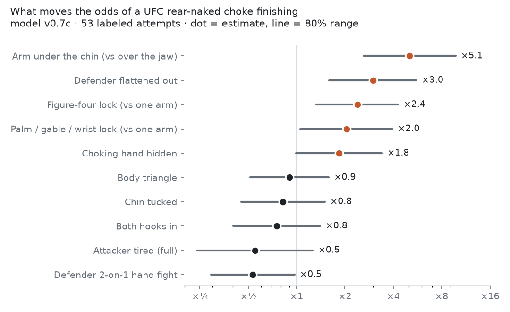
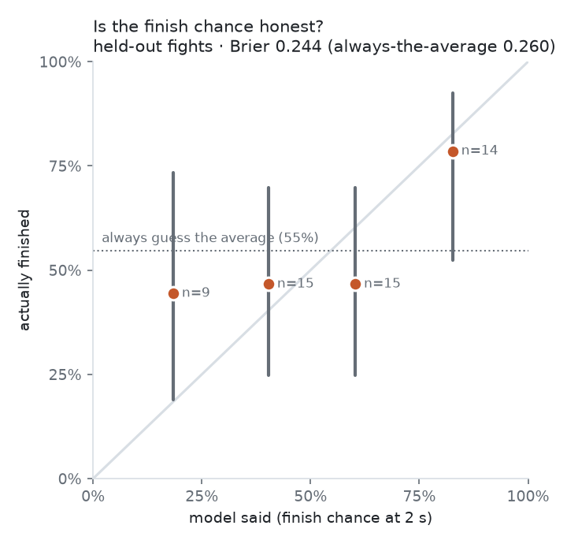

# What makes a UFC rear-naked choke finish?
### A pre-registered study of 73 hand-labeled attempts (pilot report)

*Pilot report, 2026-10-29. 73 attempts from 42 men's UFC fights. The confirmatory test runs at ~150 attempts; every result below is exploratory unless marked otherwise. Code, labels and figures are in this repository. No UFC footage is included or redistributed.*

---

> **In plain words.**
> - I hand-labeled 73 rear-naked choke attempts from UFC fights: where the choking arm was, how the hands were locked, what the legs were doing, how the defender fought it, and whether it finished.
> - In this first sample, five details lined up with more finishes:
>   - the arm under the chin (61% finished vs 40% over the jaw);
>   - a figure-four grip (68% vs 42% with one arm);
>   - a hidden choking hand (75% vs 48%);
>   - a flattened defender (66% vs 49%);
>   - beating the defender's two-handed hand fight, which halves the odds once position is taken into account.
> - Strong leg control did **not** help a single attempt finish. The likely reason: it keeps the attacker on the back for more attempts, rather than finishing any one of them.
> - Finished chokes took a median of 9.6 seconds on the neck, almost exactly what a published study of MMA choke-outs found (9.0 s).
> - The sample is small and tilted toward finishes, so the uncertainty is large. The real test was written down in advance and runs at 150 attempts.

---

## Abstract

**Background.** The rear-naked choke (RNC) is the most common submission in the UFC. Coaching folklore names its key details, but no study has measured which of them separates finished chokes from escaped ones at the elite level.

**Method.** Three hypotheses were pre-registered before any labeling:
- H1: the arm under the chin raises the odds of a finish;
- H2: strong leg control raises them;
- H3: the defender's two-on-one hand fight lowers them.

Attempts were coded at a fixed landmark (2 s after the start) with a purpose-built tool that hides the outcome.

**Pilot results** (exploratory; 72 analysable attempts, 42 fights; 95% Wilson intervals):
- Arm under the chin: 61% finished (48–72%) vs 40% (20–64%) over the jaw.
- Figure-four: 68% (51–80%) vs 42% (23–64%) for one-armed chokes.
- Hidden choking hand: 75% (53–89%) vs 48% (35–61%).
- Strong leg control: no advantage per attempt.
- In a Bayesian logistic model with expert priors, the adjusted odds multipliers were: arm under the chin ×4.6, figure-four ×3.0, flattened defender ×2.4, hidden hand ×2.0, two-on-one ×0.56 (80% ranges in Figure 1).
- Median time on the neck to a finish: 9.6 s.

**Applied.** The model gives a live finish probability.
- From the 2-s snapshot it is barely better than a base-rate guess: Brier score 0.245 vs 0.254.
- Following the position as it changes, it is clearly better: 0.224 vs 0.254.
- An automatic attempt detector reaches a frame-level ROC-AUC of about 0.75 on held-out fights.

**Conclusion.** The pilot points the way coaching expects for the arm, the grip and the hand fight. It challenges the role of leg control per attempt. The confirmatory test waits for 150 attempts.

---

## 1. Why this project

This started as a crossover between two interests: data science and the grappling side of MMA. I'm not a jiu-jitsu practitioner, but I'm a big fan. Watching UFC fights, I kept hearing commentators say a choke was "in deep" or "not under the chin". I wanted to know whether those calls could be measured, and how much each detail actually matters.

The rear-naked choke is the right place to start:
- **It's common.** RNCs are about half of all UFC choke finishes (Stellpflug 2020: 904 choke finishes, 1993–2020).
- **It's visible.** A broadcast usually shows where the arm and hands are.
- **There is a clear expert theory to test:** coaches agree on the arm, the grip, the legs and the hand fight.

**The question:** *among UFC rear-naked choke attempts, which technical states at a fixed early moment are associated with the attempt finishing?*

**What is already known.** Stellpflug et al. (2020) timed 81 MMA choke-outs: from a locked choke to unconsciousness took 9.0 s on average (95% CI 8.3–9.9 s; RNC 8.9 s). The mechanism is pressure on the carotid arteries, not the airway. That's why a forearm across the jawbone, which shields the arteries, rarely puts anyone out. No study compares grip types or leg control as predictors of the finish ([evidence review](../../research/priors_evidence/EVIDENCE.md)).

## 2. Pre-registration: deciding the test before seeing the data

With dozens of possible details and a small sample, *something* will always look important by chance. To guard against that, the hypotheses and the exact analysis were written down and frozen ([PREREG.md](../../research/rnc_science/PREREG.md), v1.0) before the first attempt was labeled.

| # | Detail at 2 s | Prediction |
|---|---|---|
| H1 | Choking arm under the chin (vs over the jaw) | More finishes |
| H2 | Body triangle or both hooks (vs less) | More finishes |
| H3 | Defender's two-on-one hand fight | Fewer finishes |
| — | Time left in the round | Adjustment only |

**Decision rule, fixed in advance.** A hypothesis is:
- *supported* if its 95% interval excludes "no effect" in the predicted direction;
- *contradicted* if it excludes it in the opposite direction;
- *inconclusive* otherwise, which is a legitimate result.

**Amendments are dated and public, never silent:**
- A1: men's divisions only.
- A2: an upper-body field and a position change log, for descriptive use.
- A3, A4: a cap of 5 attacking rounds per fighter, so one specialist can't dominate.

## 3. Data

**Population:** men's UFC fights, 2018–2026, with at least one RNC attempt.

**Sampling**, in plain terms:
- **Finish list.** Watching full fights at random to find chokes would take hundreds of hours, so most attempts come from fights known to end in an RNC (677 such finishes in the UFC's stats). This inflates the *overall* finish rate, but the *comparisons* between details stay valid, and those are what the hypotheses test. (Technically: sampling on the outcome biases the intercept of a logistic model, not its odds ratios.)
- **Failure rounds.** Rounds with flagged submission attempts that didn't finish.
- **A random subset** (planned): about 10 fully watched fights, for an honest base rate.

**Every** attempt in a watched round is labeled, including failed attempts before a finish.

**This pilot:** 73 attempts from 42 fights; 72 are analysable (one ended at the bell). 64 come from finish-list fights and 8 from failure rounds. The sample is heavily tilted toward finishes: 56% finished overall, far above reality. **Read the rates as comparisons with each other, never as real-world chances.**

**Footage:** official UFC uploads and licensed broadcasters only, watched locally. Videos are deleted after processing, and only labels and numeric features are kept.

## 4. How an attempt is coded

**What counts as an attempt:**
- the attacker has back control;
- the choking arm is across the neck (under the chin or over the jaw);
- the second hand is working to lock it.

If the choke is reset in under 2 seconds without losing the back, it's still the same attempt.

**The 2-second landmark.** A labeling tool written for this project pauses the video 2 seconds into each attempt and asks a fixed panel of questions *before* the outcome is visible:
- arm position;
- grip type;
- leg control;
- the defender's two-on-one;
- chin tucked;
- choking hand hidden;
- defender flattened.

Coding at a fixed early moment, blind to the outcome, prevents the natural bias of describing finished chokes as "tighter". Changes after the landmark (e.g. the grip switching to a figure-four) are logged with timestamps.

**Outcomes:**
- **Success:** tap, referee stoppage or unconsciousness.
- **Failure:** escape or the attacker abandoning the choke.
- **Censored:** the round ends first (a "bell").

**Quality control** is automated: overlapping attempts, impossible times, mismatches with official finish times, out-of-scope fights and cap violations. The pilot passes with zero errors.

**Reliability** (🔴 pending): a second rater will code at least 30 attempts. Any detail with agreement below κ = 0.4 (Cohen's kappa: agreement beyond chance, from 0 to 1) will be reported as "not reliably codable from broadcast".

## 5. Results (exploratory)

### 5.1 Finish rate by detail

Rates at the 2-second landmark, with 95% Wilson intervals: the range the true rate plausibly lies in, given the sample size. Source: [findings_pilot.md](../../reports/findings_pilot.md).

| Detail | Value | Attempts | Finished | 95% interval |
|---|---|---|---|---|
| **Arm** (H1) | under the chin | 56 | **61%** | 48–72% |
| | over the jaw | 15 | 40% | 20–64% |
| **Grip** | figure-four | 37 | **68%** | 51–80% |
| | palm / gable / wrist pull | 10 | 50% | 24–76% |
| | one arm / short choke | 19 | 42% | 23–64% |
| **Legs** (H2) | body triangle | 24 | 46% | 28–65% |
| | both hooks | 26 | 54% | 35–71% |
| | one hook / none | 22 | **68%** | 47–84% |
| **Defender two-on-one** (H3) | yes | 23 | 57% | 37–74% |
| | no | 49 | 55% | 41–68% |
| **Choking hand hidden** | yes | 20 | **75%** | 53–89% |
| | no | 52 | 48% | 35–61% |
| **Defender flattened** | yes | 29 | **66%** | 47–80% |
| | no | 43 | 49% | 35–63% |

### 5.2 Effects with the other details held fixed

The raw rates mix details together: deep chokes tend to be figure-fours with the arm under the chin. A logistic model separates them. It estimates how much each detail multiplies the odds of a finish while the others stay the same. Its starting points are expert scenario estimates and a published-evidence review, each counting as only a few pretend attempts, and the labels then pull the numbers toward what the fights actually show (details in [MODEL_SPEC.md](../MODEL_SPEC.md)).

*Figure 1.* Odds multipliers. Arm under the chin ×4.6 (80% range 2.4–8.7), figure-four ×3.0 (1.7–5.1), flattened ×2.4 (1.4–4.2), hidden hand ×2.0 (1.1–3.6), other locks ×2.0 (1.1–3.8), defender two-on-one ×0.56 (0.33–0.96), body triangle ×1.0 (0.6–1.6).

### 5.3 Time on the neck

| | Median | Middle half |
|---|---|---|
| Finished chokes (n = 40) | **9.6 s** | 6.5–12.9 s |
| Failed attempts (n = 32) | 9.6 s | 6.3–15.1 s |

Finishes landed at almost exactly the 9.0 s from lock to unconsciousness measured in MMA (Stellpflug 2020), an independent check on the labels. Duration alone doesn't separate finishes from failures; position does.

### 5.4 What the pilot says about each hypothesis

- **H1 (arm under the chin): points the predicted way, strongly** (raw 61% vs 40%; adjusted ×4.6).
- **H3 (two-on-one): points the predicted way, but only after adjustment.** Raw rates are equal (57% vs 55%) because defenders hand-fight hardest when the choke is already deep. Once position is accounted for, the hand fight roughly halves the odds (×0.56).
- **H2 (leg control): points the opposite way per attempt** (body triangle 46%, one hook/none 68%; adjusted ×1.0). See section 6.

These are pilot readings. The confirmatory test (Firth logistic regression with profile intervals, a bootstrap by attacker, and sensitivity checks; [prereg_analysis.py](../../research/rnc_science/prereg_analysis.py)) runs at 150 attempts.

## 6. Discussion

**Leg control: retention, not finishing.** The most surprising pilot result is that a body triangle or both hooks did not make a single attempt more likely to finish. The best explanation is that **leg control buys time on the back, not the finish itself**:
- An attacker with a locked body triangle can keep attacking for a whole round, so their rounds contain more attempts, and the early ones fail before one lands.
- Scored attempt by attempt, those early failures count against the body triangle.
- Its real value would only show in a model of the *whole back exposure*: how long the attacker keeps the back, and whether *any* attempt in it finishes.

A second, smaller factor: many quick finishes come right after a knockdown, on a dazed opponent, before any hooks are in. That detail isn't labeled yet.

**The hand fight hides behind position.** The two-on-one shows no raw effect but a clear adjusted one. It's a reminder that raw percentages from fight footage can mislead, and that the comparisons need a model.

**The grip order matches coaching.** Figure-four > palm/gable/wrist lock > one arm, in both views. No published study has measured this before.

**How much the data can say (power).** Simulations of the pre-registered test show that at 150 attempts, a large effect like H1 (odds ×4) is detected almost always, while a moderate one (×2) is detected only ~42% of the time. Some real effects will honestly come out "inconclusive", and the paper will say so rather than hunt for significance.

## 7. Applied tools (summary)

**Live finish probability.**
- The same model, run second by second, powers a replay overlay. It shows the attacker's finish chance, plus the defender's "HP": a blood-flow dose that drains with squeeze strength and empties after ~9 s of a full squeeze.
- Tested on fights it never saw (leave-one-fight-out), the 2-second snapshot barely beats a base-rate guess (Brier 0.245 vs 0.254, within noise). Following the position as it changes, it does clearly better (0.224 vs 0.254).
- When it says ~80%, those attempts finished ~80% of the time (Figure 2). In its lower range it is too pessimistic.

**Automatic detection.**
- Pose skeletons fail in tangled grappling (both fighters correct in 4 of 48 frames), so the detector uses general-purpose image features (CLIP) of the fighters plus the last few seconds of motion.
- On held-out fights it reaches a frame-level ROC-AUC of ~0.75 (0.5 = guessing, 1 = perfect). It recognizes a back attack but not the exact second a choke starts, and it gives 0.7–1.0 false alarms per minute.
- Recognizing the details themselves from video is not there yet: agreement with the labels was near chance in a first test ([factor_pilot.md](../../reports/factor_pilot.md)).

## 8. Limitations

- **Small and finish-heavy sample:** 72 attempts, 64 from finish-list fights. Wide intervals, inflated overall rate.
- **One rater so far.** Reliability is untested.
- **Broadcast views** hide the hands at times. Some details are "unclear", and camera cuts hide parts of attempts.
- **Per-attempt scoring** can't credit position retention (section 6).
- **Unlabeled confounders:** knockdowns before the back take, fatigue, the cage.
- **Expert priors** in the applied model are opinion, weighted lightly and disclosed. The pre-registered test uses data only.
- **Supply:** free official footage covers only part of the target sample.

## 9. Next steps

1. **Model whole back exposures.** Treat each back take as the unit: how long the attacker keeps the back, how many attempts they get, and whether any finishes. This directly tests the retention explanation for leg control.
2. **Let the computer see the details.** Train a model on tight head-and-neck crops, saved for every labeled attempt, so the arm position, grip and hand fight no longer need hand labels. The decision point is ~150 attempts.
3. Reach 150 attempts (with more failure rounds and the random subset), add a second rater, and run the pre-registered test exactly as written.

## 10. Ethics and data

No UFC footage is stored in the repository, uploaded or shared. Only timestamps, labels and numeric features are kept. A release check scans the repository and its history for video files and secrets before any public release.

## References

- Stellpflug SJ, Menton TR, Dummer MF, Menton WH, Corry JJ, LeFevere RC (2020). Time to loss of consciousness from locked chokes in mixed martial arts. *International Journal of Performance Analysis in Sport* 20(4):720–728. doi:10.1080/24748668.2020.1780873 (title paraphrased; see the DOI).
- Stellpflug SJ (2020). Choke submissions in UFC history, 1993–2020. PMID 33347362.
- Firth D (1993). Bias reduction of maximum likelihood estimates. *Biometrika* 80:27–38.
- Radford A, et al. (2021). Learning transferable visual models from natural language supervision (CLIP). *ICML.*
- Project documents: [PREREG.md](../../research/rnc_science/PREREG.md), [FACTORS.md](../../research/rnc_science/FACTORS.md), [LABEL_SCHEMA.md](../../phase3_labels/LABEL_SCHEMA.md), [MODEL_SPEC.md](../MODEL_SPEC.md), [EVIDENCE.md](../../research/priors_evidence/EVIDENCE.md).
